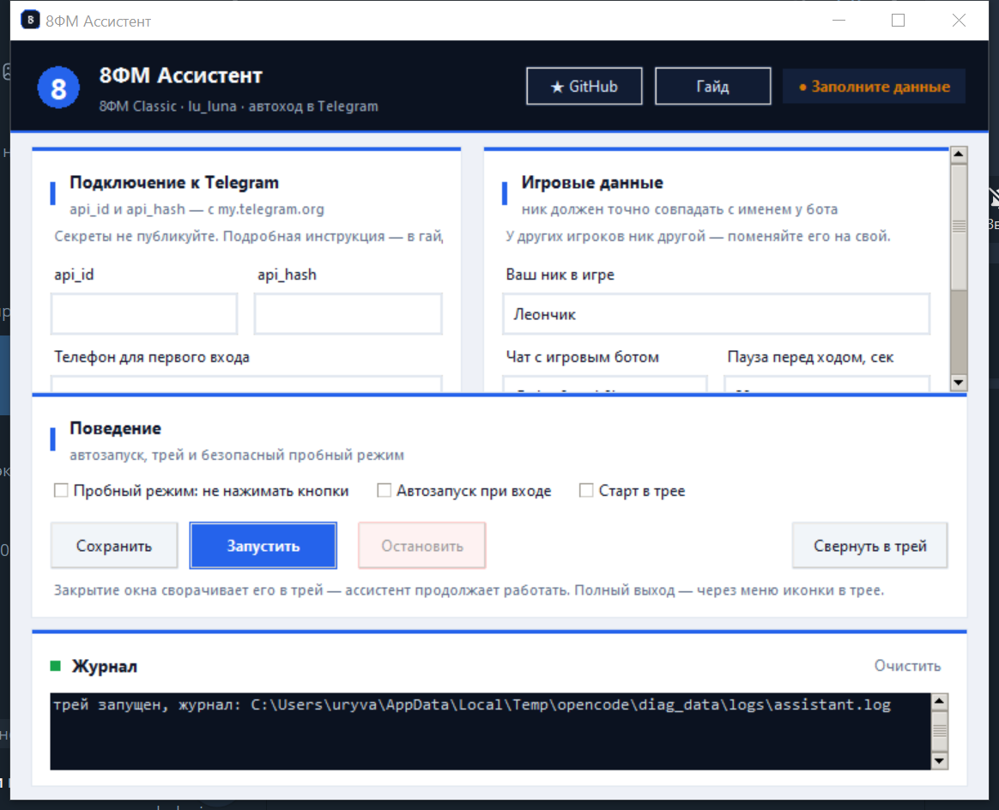
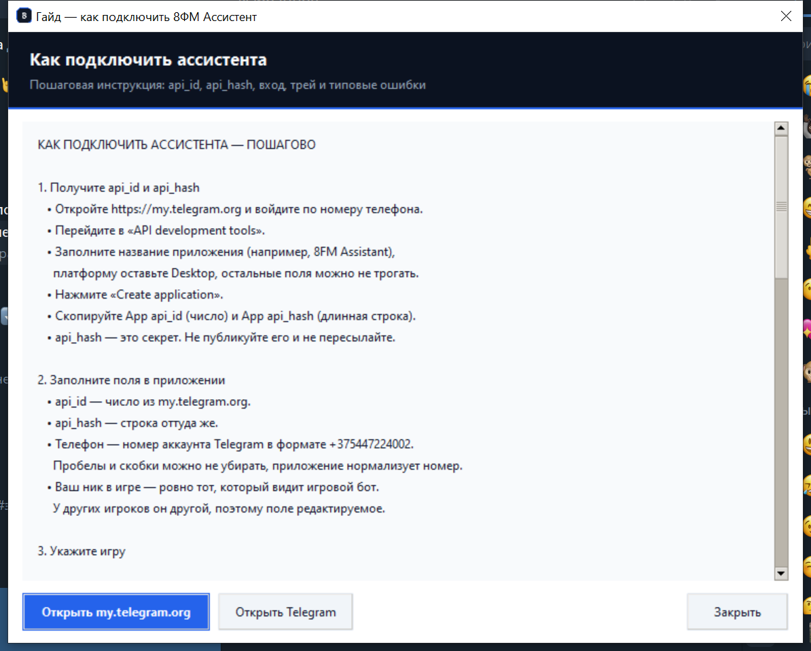
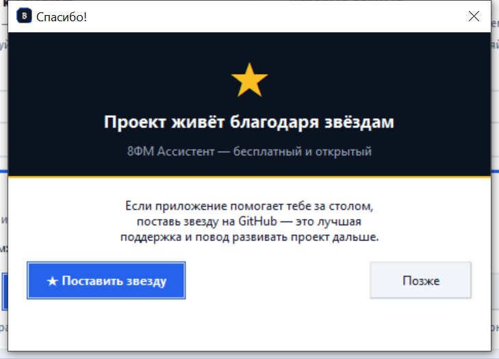

# 8ФМ AI — ассистент и RL-политика для 8ФМ Classic

[](LICENSE)
[](https://github.com/leonka123/8FM_AI/releases/tag/v1.0.0)
[](https://www.python.org/)
[](#сборка-exe-windows)
[](https://github.com/leonka123/8FM_AI)

**8ФМ AI** — это готовое десктоп-приложение для Windows, которое пассивно живёт в системном трее, читает сообщения игрового бота `@phys8math8bot` в Telegram и само выбирает ход моделью **lu_luna** (RL, обученная в self-play). Плюс полный офлайн-стек: аудит архива, обучение score-модели и supervised-политики, симулятор на 3–7 игроков, ансамбль `lu_nsmbl` и CLI для всего этого.

Приложение не работает без твоих Telegram-данных: ты сам вводишь `api_id`, `api_hash` и телефон, входишь по коду и только потом включаешь ассистента.

> **Версия 1.0** — первый публичный релиз: десктоп-приложение, трей, автозапуск, вход по коду/2FA, встроенный гайд и модель `lu_luna` по умолчанию.

> ⭐ **Понравился проект? Поставь звезду:** <https://github.com/leonka123/8FM_AI>
>
> Это бесплатный open-source проект. Звезда — лучшая поддержка и повод развивать его дальше. При первом запуске приложение само напомнит об этом.

## Скриншоты

<p align="center">
  
</p>

<p align="center">
  
  
</p>

## Быстрый старт

1. **Скачай** `8FM-Assistant.exe` из [Releases](https://github.com/leonka123/8FM_AI/releases/latest) или собери сам (см. [сборку](#сборка-exe-windows)).
2. **Получи API-доступ**: зайди на <https://my.telegram.org> → «API development tools» → создай приложение → скопируй `api_id` и `api_hash`.
3. **Запусти приложение**, заполни `api_id`, `api_hash`, телефон и свой ник в игре. Модель уже выбрана — `lu_luna`.
4. **Нажми «Запустить»** и введи код из чата «Telegram» (при 2FA — ещё и пароль).
5. **Проверь**: статус в шапке стал зелёным, в журнале появились строки. Для первой проверки включи «Пробный режим».
6. **Закрой окно крестиком** — приложение свернётся в трей и продолжит работать. Автозапуск включён по умолчанию.

Подробная инструкция с ошибками — ниже и во встроенном «Гайде» (кнопка в шапке приложения).

## Скачать

| Что | Где |
|---|---|
| Готовый `.exe` для Windows 10/11 x64 | [Releases → 8FM-Assistant.exe](https://github.com/leonka123/8FM_AI/releases/latest) |
| Исходники | `git clone https://github.com/leonka123/8FM_AI.git` |
| Сборка из исходников | `python -m pip install -r requirements-desktop.txt` → `python run_assistant_app.py` |

`.exe` собирается автоматически в GitHub Actions при пуше тега `v*` и прикладывается к релизу. Python на компьютере пользователя не нужен. Файл не подписан, поэтому SmartScreen может спросить подтверждение: «Подробнее» → «Выполнить всё равно».

## Подключение Telegram: пошагово

1. **Создай приложение в Telegram.** Открой <https://my.telegram.org>, войди по номеру телефона, перейди в «API development tools». Название любое (например, `8FM Assistant`), платформа — Desktop. Нажми «Create application». Появятся **App api_id** (число) и **App api_hash** (длинная строка).
2. **Заполни поля в приложении.** `api_id` — только цифры, `api_hash` — строка целиком. Телефон — с кодом страны: `+375447224002`; пробелы и скобки приложение уберёт само.
3. **Укажи игровые данные.** Ник — ровно тот, который видит бот (у других игроков он другой). Чат — `@phys8math8bot`. Пауза — 20 секунд. Модель оставь `models/lu_luna.json`.
4. **Войди.** Нажми «Запустить». Код приходит в служебный чат «Telegram», а не по SMS. Если включена двухэтапная проверка — введи пароль 2FA. Сессия сохранится, повторно код не нужен.
5. **Включи пассивный режим.** Галочки «Автозапуск при входе» и «Старт в трее». Крестик окна = свернуть в трей; полный выход — только через меню иконки в трее.
6. **Проверь безопасно.** Включи «Пробный режим: не нажимать кнопки» — ассистент покажет решение в журнале, но не тронет игру.

### Если что-то не работает

| Проблема | Что делать |
|---|---|
| `database is locked` | Запущен второй экземпляр ассистента (или старая консольная версия). Закрой его: приложение не даёт открыть два окна, но старый процесс мог остаться. |
| Не приходит код | Проверь номер с кодом страны. Подожди и запроси снова: Telegram ограничивает частые запросы. |
| `api_id должен быть числом` | Скопируй из my.telegram.org только цифры, без подписи «App api_id». |
| Ошибка входа / сессия сломалась | Удали `%APPDATA%\8FM Assistant\session` и войди заново. Настройки при этом сохранятся. |
| Не нажимает кнопку | Нужен пак `8ФМ Classic` без модификаторов, точный ник и сообщение с кнопками выбора. При модификаторах ход остаётся за тобой. |
| SmartScreen / антивирус | Неподписанная one-file сборка PyInstaller. «Подробнее» → «Выполнить всё равно»; при желании собери сам из исходников. |
| Не запускается `.exe` | Нужна Windows 10/11 x64. На Linux/macOS собирай отдельно; исходники кроссплатформенные. |

### Безопасность

- `api_hash` и файл сессии — это доступ к аккаунту. **Никогда не коммить их.** В репозитории `telegram-config.json` и `*.session` исключены через `.gitignore`; для примера есть `telegram-config.example.json`.
- Пароль 2FA вводится только в диалоге приложения и нигде не сохраняется.
- Настройки, сессия и логи лежат локально в `%APPDATA%\8FM Assistant\`.

## Содержание

- [Скачать](#скачать) · [Подключение Telegram](#подключение-telegram-пошагово) · [Требования](#требования)
- [Десктоп-приложение (окно + трей)](#десктоп-приложение-окно--трей) · [Ресурсы в пассивном режиме](#ресурсы-в-пассивном-режиме) · [Сборка `.exe`](#сборка-exe-windows)
- [Автовыбор хода в Telegram](#автовыбор-хода-в-telegram-lu_luna) · [Игра в терминале](#игра-в-терминале)
- [Модель lu_luna](#модель-lu_luna) · [Абсолютная модель (Kaggle)](#абсолютная-модель-lu_luna_absolute) · [Ансамбль моделей](#ансамбль-моделей) · [RL-политика](#rl-политика)
- [Тесты](#тесты) · [Ограничения](#ограничения) · [Лицензия](#лицензия)

## Что внутри

- **`lu_luna`** — actor-critic RL-политика, обученная в self-play на 3–7 игроков; финальная модель в `models/lu_luna.json`.
- **`lu_luna_absolute`** — максимальная конфигурация (расклад признаков `v2`, сеть 512/256/256, длинное обучение); обучается на внешних мощностях, харнесс в `kaggle/`.
- **Ансамбль `lu_nsmbl`** — `lu_luna` + `classic-rl` + supervised с весами и температурой.
- **Полный симулятор Classic** — легальность ходов, раунды, открытые/закрытые карты, подсчёт очков.
- **Аудит и обучение** — разбор публичного JSON-экспорта, score-модель, listwise-политика.
- **Telegram-ассистент** — userbot через Telethon, задержка 20 секунд, инлайн-кнопки «открыто/закрыто».
- **Десктоп-оболочка** — окно настроек, трей, автозапуск, встроенный гайд, вход по коду/2FA.

## Требования

- Python 3.10 или новее
- Для аудита, разбора сообщений и `play` без обучения дополнительные пакеты не нужны
- Для обучения score-модели, supervised-политики и RL: `python -m pip install -r requirements-training.txt` (NumPy и matplotlib)
- Для необязательного `telegram-assistant`: `python -m pip install -r requirements-telegram.txt` (Telethon)
- Для десктоп-приложения с окном и треем: `python -m pip install -r requirements-desktop.txt` (Telethon, pystray, Pillow, NumPy)
- Без matplotlib метрики всё равно сохраняются, но PNG/SVG-графики не создаются

## Запуск аудита

Из корня папки проекта:

```powershell
python -m eightfm audit database.json
python -m eightfm audit database.json --json
```

Описательная статистика по архивным действиям:

```powershell
python -m eightfm history database.json
python -m eightfm history database.json --json
```

## Score-модель

Обучить небольшой MLP на завершённых играх Classic без модификаторов и сохранить модель:

```powershell
python -m eightfm train database.json
```

Команда выводит ошибку на отложенных партиях и сравнение с простым прогнозом средним значением. Целевая величина — записанное изменение счёта сыгранного хода, а не вероятность победы: в архиве нет невыбранных альтернатив, поэтому эта модель сама по себе не доказывает, что одна карта лучше другой. Она остаётся вспомогательной.

## Supervised-политика

Политика ранжирует все карты, которые видны в руке, и отдельный вариант «закрыто». Она обучается на ходах игроков, набравших больше 60 очков; вес примера растёт с успехом, запасом по счёту и местом в партии.

```powershell
python -m eightfm train-policy database.json
```

По умолчанию модель сохраняется в `models/classic-policy.json`. Команда печатает top-1 на отложенных партиях, top-1 на успешных игроках, MRR и сравнение с частотным baseline.

Скопируйте игровое сообщение в UTF-8 файл и запросите ход:

```powershell
python -m eightfm play --player "Леончик" --message-file message.txt
python -m eightfm play --player "Леончик" --message-file message.txt --json
```

`play` — это совет, а не отправка хода. Для каждого варианта выводятся policy-score, нормированная вероятность и, если доступна score-модель, её прогноз прироста счёта. Имя по умолчанию — `Леончик`; `--model` и `--score-model` позволяют указать другие файлы. Сообщения без строки «8ФМ Classic» отклоняются: помощник поддерживает только этот режим.

Текущая сохранённая supervised-модель (`seed 41`, hidden 64) обучена на 50 774 состояниях из 1 148 партий и проверена на 13 000 состояниях из 288 отложенных партий:

- top-1 — **67.3%** (на состояниях успешных игроков **70.0%**);
- top-3 — **97.6%** (на успешных **97.6%**);
- MRR — **0.817**, средний ранг выбранной карты — **1.46**;
- частотный baseline top-1 — 21.0% (на успешных 9.8%).

Ограничение: это имитация ходов успешных игроков, а не доказанный оптимальный ход. В архиве нет исходов невыбранных карт, поэтому top-1, top-3 и MRR — прокси-метрики, а не измеренная частота побед.

## Симулятор Classic

`eightfm/rules.py` содержит точные правила и скоринг, откалиброванные по архиву: **0 расхождений на 66 610 ходах**. `eightfm/env.py` — полный симулятор:

- 3, 4, 5, 6 и 7 игроков;
- одна колода на игру, `12 * N` карт, две раздачи по `6 * N` (по 6 карт каждому в каждом раунде);
- 5 одновременных ходов за раунд, две передачи рук: раунд 1 — соседу с offset `-1`, раунд 2 — с offset `+1`;
- точные эффекты всех 14 карт, включая глобальный счётчик открытых Алексеев для Детектора;
- легальность: открытая Ваня требует хотя бы одну свою закрытую карту; открытые Марат/Детектор запрещены, если у игрока уже есть открытый Алексей;
- наблюдение 115 признаков, пространство действий 25 признаков на кандидата;
- плотная награда за относительное изменение счёта плюс терминальная награда за победу, место, очки, `>60` и маржу.

Проверки симулятора входят в `tests/test_env.py` и `tests/test_rules.py`.

## RL-политика

`eightfm/rl.py` содержит actor-critic сеть, PPO-обновление, GAE(`lambda = 0.95`), Adam, сохранение/загрузку и behaviour cloning. `eightfm/rl_train.py` — сбор эпизодов, self-play и league-режим, оценку, обучение, метрики и графики.

Схема обучения:

1. **Warm start.** Behaviour cloning на 800 играх симулятора с combo-учителем (`ComboPolicy`): он коммитится в Алексея 7+, Олимпиаду 6+, Акима 3+, Леонидию 2+, ровно 2 Амогуса, Женю 4+, Ваню 3+, Сергея 4+; иначе играет жадно. Это даёт политике комбо-стратегию, которую чисто жадная политика не находит.
2. **Self-play + league.** 50% эпизодов — все места за обучаемой сетью; 50% — половина мест за сетью, остальные за combo/greedy/supervised/random. Это не даёт политике подстроиться только под собственный стиль.
3. **PPO.** 4 эпохи на собранный батч, clip 0.2, entropy 0.02, GAE. Награда: терминальная за победу/место/очки/`>60`/маржу плюс плотная относительная награда с весом 0.08.
4. **Checkpoint selection.** Best и latest сохраняются раздельно. Best выбирается по композитному скору `0.45 * supervised + 0.30 * greedy + 0.25 * combo` — приоритет у модели, которую нужно обойти, затем у greedy, затем у combo-эвристики.

Обучение:

```powershell
python -m eightfm train-rl
python -m eightfm train-rl --updates 160 --games-per-update 32 --seed 47
python -m eightfm train-rl --resume models/classic-rl-latest.json --updates 80
```

По умолчанию сохраняются:

- `models/classic-rl.json` — лучший checkpoint;
- `models/classic-rl-latest.json` — последняя сеть;
- `models/classic-rl-metrics.json` — конфиг, warm start, история обновлений и оценок;
- `plots/classic-rl-training.png` и `.svg` — loss, reward, entropy, win rate и eval-кривые. Policy loss на графике — это PPO surrogate: он колеблется около нуля и может быть отрицательным. Устойчиво снижается value loss, а terminal reward, GAE return и средний счёт растут.

Рекомендация по скопированному сообщению:

```powershell
python -m eightfm play-rl --player "Леончик" --message-file message.txt
python -m eightfm play-rl --player "Леончик" --message-file message.txt --top 5
python -m eightfm play-rl --player "Леончик" --message-file message.txt --json
```

`play-rl` восстанавливает наблюдение из сообщения: руку, открытые и закрытые карты на столе, счёт, раунд, ход и направление передачи. История обоих раундов сохраняется, как в симуляторе: карты первого раунда продолжают учитываться в cumulative-счёте и эффектах. Скрытые карты не подставляются. Выводятся policy-score, вероятность, немедленный прирост счёта и оценка состояния. Это совет; ход нужно подтвердить в игре самостоятельно.

Оценка на отложенных seed'ах:

```powershell
python -m eightfm eval-rl --model models/classic-rl.json --games 100 --seed-base 90000
python -m eightfm eval-rl --model models/classic-rl.json --games 100 --json --output models/classic-rl-eval.json
```

`eval-rl` ставит политику в одно место, а все остальные места — за фиксированным противником, и ротирует место кандидата по играм. Сравнение идёт с greedy, supervised, combo и random; для каждого размера печатается win rate, а также средний счёт, место и доля `>60`.

### Результаты

Финальная модель (best checkpoint — update 120 из 160) оценена на 100 играх на каждого противника для каждого числа игроков (seed'ы 90 000+, не использовавшиеся при обучении):

| Противник | 3 игрока | 4 игрока | 5 игроков | 6 игроков | 7 игроков | Среднее | Случайное |
|---|---:|---:|---:|---:|---:|---:|---:|
| supervised | 0.85 | 0.77 | 0.77 | 0.81 | 0.68 | **0.776** | 0.22 |
| greedy | 0.50 | 0.38 | 0.31 | 0.32 | 0.32 | **0.366** | 0.22 |
| combo | 0.89 | 0.72 | 0.90 | 0.83 | 0.81 | **0.830** | 0.22 |
| random | 1.00 | 1.00 | 0.99 | 1.00 | 0.99 | **0.996** | 0.22 |

Средний счёт финальной модели: 54.5 против greedy, 59.3 против supervised, 61.8 против combo. Доля игр `>60`: 17.2%, 40.8% и 52.4% соответственно.

Колонка «Случайное» — среднее `1/N` по размерам 3–7 (0.22); по отдельным размерам chance равен 0.33, 0.25, 0.20, 0.17 и 0.14.

Главная цель — обойти supervised-модель — выполнена с большим запасом: 0.78 против случайного уровня 0.22. Greedy обыгран в среднем (0.37 против 0.22) и выше случайного уровня на всех размерах, включая 5 игроков (0.31 при 0.20). Combo-эвристика, которую RL использует как учителя и противника, обыграна на всех размерах.

## Модель lu_luna

`lu_luna` — самая сильная RL-конфигурация проекта: та же игра и то же окружение, но шире сеть и агрессивнее рецепт обучения. Команда:

```powershell
python -X utf8 -m eightfm train-lu-luna
```

Отличия от базового `train-rl`:

- **Сеть шире.** Башни состояния 256 и 128, башня действия 128 (у базовой модели — 128/64/64).
- **Дольше warm start.** 2000 игр behaviour cloning с combo-учителем и 8 эпох вместо 800/4.
- **Лучшая система лоссов.** PPO с value clipping (`0.2`), Huber-лоссом value (`delta = 1.0`) вместо чистого MSE и ранней остановкой по приближённому KL (`target = 0.03`), чтобы одно обновление не сломало политику. Advantage нормализуется, градиент клипуется.
- **Расписания.** Линейно падают learning rate (`3e-4 → 4e-5`) и entropy (`0.03 → 0.004`) — сначала исследование, потом доработка.
- **Self-play league.** Кроме combo/greedy/supervised/random каждые 10 обновлений в пул противников добавляется замороженная копия прошлого чекпоинта (до 8 штук, вес 0.3). Политика не может «застыть» против собственного стиля.
- **Champion-aware отбор.** Best-checkpoint выбирается не только по композитному скору против ботов, но и по личной встрече с действующим чемпионом `models/classic-rl.json`: к скору добавляется бонус за перевес по win rate над случайным уровнем. Так «топ-1» означает «сильнее и ботов, и прошлой лучшей модели», а не просто «хорош против ботов».
- **Curriculum 3 → 7** и большая оценка (30 игр на размер) каждые 10 обновлений.
- **Архив чекпоинтов.** Каждые 20 обновлений сеть сохраняется в `models/lu_luna-checkpoints/update-XXXX.json`, чтобы финальную модель можно было перевыбрать офлайн через `rank_checkpoints`.

Обучение: 320 обновлений × 32 игры, seed 2024, около 70 минут; warm start — 2000 игр, BC accuracy 0.889. Best checkpoint — **update 280** (композитный скор 0.841).

### Результаты lu_luna

Финальная модель (best, update 280) оценена на 100 играх на каждого противника для каждого числа игроков (seed'ы 90 000+, не использовавшиеся при обучении):

| Противник | 3 игрока | 4 игрока | 5 игроков | 6 игроков | 7 игроков | Среднее | Случайное |
|---|---:|---:|---:|---:|---:|---:|---:|
| supervised | 0.83 | 0.74 | 0.78 | 0.82 | 0.66 | **0.766** | 0.22 |
| greedy | 0.58 | 0.47 | 0.32 | 0.39 | 0.39 | **0.430** | 0.22 |
| combo | 0.86 | 0.75 | 0.87 | 0.89 | 0.81 | **0.836** | 0.22 |
| random | 0.96 | 0.99 | 0.99 | 1.00 | 0.99 | **0.986** | 0.22 |

Средний счёт: 55.2 против greedy, 59.1 против supervised, 61.9 против combo. Доля игр `>60`: 17.2%, 39.2% и 51.4% соответственно.

Личная встреча с прежним чемпионом `models/classic-rl.json` (кандидат занимает одно место, противник — все остальные, 100 игр на формат, места ротируются):

| Модель | Win rate | Средний счёт | Маржа |
|---|---:|---:|---:|
| lu_luna (update 280) | **0.312** | 55.16 | **+1.03** |
| lu_luna v1 (latest, update 320) | 0.308 | 55.23 | +0.98 |
| lu_luna v1 (best, update 130) | 0.218 | 53.62 | −0.44 |
| classic-rl (зеркало) | 0.242 | 54.03 | −0.36 |

Случайный уровень в этой встрече — 0.219. Финальная `lu_luna` выигрывает у `classic-rl` заметно выше chance и с положительной маржой, тогда как зеркальная встреча `classic-rl` против самой себя даёт перевес ниже chance и отрицательную маржу: преимущество не сводится к bias места за столом.

Игра и сравнение с `lu_luna`:

```powershell
# сыграть против lu_luna (второе место — supervised)
python -X utf8 -m eightfm play-game --model models/lu_luna.json

# оценить на отложенных seed'ах
python -X utf8 -m eightfm eval-rl --model models/lu_luna.json --games 100 --seed-base 90000

# бенчмарк lu_luna против supervised в одних играх
python -X utf8 -m eightfm benchmark-models --model models/lu_luna.json --games 20 --players 3,4
```

Сохранённые артефакты:

- `models/lu_luna.json` — финальная модель (best, update 280);
- `models/lu_luna-latest.json`, `models/lu_luna-metrics.json` — последняя сеть (update 320) и метрики обучения;
- `models/lu_luna-v1.json`, `models/lu_luna-v1-latest.json`, `models/lu_luna-v1-metrics.json` — предыдущий прогон (best update 130);
- `plots/lu_luna-training.png`/`.svg` — графики финального прогона; `plots/lu_luna-v1-training.png`/`.svg` — графики первого.

## Абсолютная модель (lu_luna_absolute)

«Абсолютная» модель — максимальная конфигурация проекта: больше данных в начальном векторе, шире сеть, дольше обучение. Она рассчитана на внешние мощности (Kaggle), потому что на ноутбуке такой прогон идёт часами.

```powershell
python -X utf8 -m eightfm train-absolute --workers 4
```

Что замаксили по сравнению с `lu_luna`:

- **Больше данных в векторе (расклад `v2`).** К прежним 115 входам состояния и 25 входам действия добавлены 43 и 7 значений: прогресс и достижимость комбо по каждой комбо-карте, очки от закрытых карт у себя и на столе, контекст хода (первый/последний ход, последний раунд, сколько ходов осталось), давление открытых карт соперников (топ-6 + среднее/максимум), давление Alexey (у себя, на столе, максимум у соперника) и близость к порогу успеха `60`. Итог — **158 входов состояния / 32 входа действия**.
- **Шире сеть.** 512/256 в башне состояния, 256 в башне действия (у `lu_luna` — 256/128/128).
- **Дольше warm start.** 6000 игр behaviour cloning и 16 эпох против 2000/8.
- **Больше PPO.** Батч 1024, 8 эпох, до 3000 обновлений по 48 игр (у `lu_luna` — 512, 6, 320×32).
- **Свободнее лига.** Замороженный снимок каждые 25 обновлений, пул до 12, вес 0.3.
- **Ширше оценка.** 60 игр на формат каждые 25 обновлений и личная встреча с чемпионом на 40 играх.
- **Расписания.** learning rate `3e-4 → 2e-5`, entropy `0.035 → 0.003`.

### Обучение на Kaggle

Локально такой прогон идёт слишком долго, поэтому обучение вынесено на внешний compute. Готовый харнесс лежит в `kaggle/`:

- `kaggle/train_absolute.py` — возобновляемый драйвер: учит модель чанками по времени, хранит `driver_state.json`, продолжает с того же шага в новой сессии и держит единое монотонное расписание learning rate / энтропии;
- `kaggle/8fm-absolute-training.ipynb` — ноутбук для Kaggle (клонирует репозиторий, запускает драйвер, показывает артефакты);
- `kaggle/README.md` — пошаговая инструкция.

Коротко: включите в Kaggle **Internet: On** и **Accelerator: None** (GPU не нужен — узкое место это чистый Python-симулятор, ускоряет только параллельный сэмплинг `--workers 4`), загрузите `kaggle/8fm-absolute-training.ipynb` и запустите **Save & Run All**. Одна сессия Kaggle (~12 ч) не вмещает весь прогон, но повторный запуск продолжает обучение с места остановки.

То же самое вручную:

```powershell
git clone https://github.com/leonka123/8FM_AI
cd 8FM_AI
python kaggle/train_absolute.py --work-dir /kaggle/working --workers 4 --total-updates 6000 --chunk-updates 200
```

Артефакты: `lu_luna_absolute.json` (лучшая модель), `lu_luna_absolute-latest.json` (для продолжения) и `lu_luna_absolute-metrics.json`. Флаги `--feature-version` и `--workers` доступны и у `train-rl`/`train-lu-luna`.

> Расклад признаков `v2` несовместим со старыми чекпоинтами (`v1`), поэтому продолжать обучение `absolute` можно только из `absolute`-чекпоинтов. Старая `lu_luna` при этом работает как есть: сеть хранит свою версию признаков и загружается без изменений.

## Ансамбль моделей

`lu_luna`, `classic-rl` и supervised смотрят на одно и то же наблюдение симулятора, но ошибаются по-разному. `eightfm/ensemble.py` сводит их мнения в одно взвешенное голосование:

```text
P(ход) = Σ_i w_i · softmax(score_i / T_i) / Σ_i w_i
```

Каждый участник превращает свои сырые оценки ходов в распределение softmax с температурой `T_i`, распределения смешиваются с весами `w_i`, и играется ход с наибольшей итоговой вероятностью. Участники не видят скрытых карт друг друга — смешиваются только их оценки одних и тех же легальных ходов.

По умолчанию ансамбль — это `lu_luna 0.50 + classic-rl 0.30 + supervised 0.20` (температура `1.0` у всех). Веса и температуры задаются явно, а конфигурация сохраняется в JSON.

```powershell
# посмотреть состав и сохранить конфигурацию (ансамбль называется lu_nsmbl)
python -X utf8 -m eightfm ensemble --no-eval --name lu_nsmbl --save models/lu_nsmbl.json

# свои веса и температуры
python -X utf8 -m eightfm ensemble --weights 0.5,0.3,0.2 --temperatures 1,1,1 --no-eval

# оценить ансамбль против ботов и против собственных участников
python -X utf8 -m eightfm ensemble --games 50

# сыграть против ансамбля (или против загруженного файла конфигурации)
python -X utf8 -m eightfm play-game --opponents ensemble,supervised
python -X utf8 -m eightfm play-game --opponents "ensemble:models/lu_nsmbl.json,rl"
```

- `--members` — участники через запятую: псевдонимы (`lu_luna`, `classic-rl`, `supervised`) или `kind:path` (`rl:models/lu_luna.json`); по умолчанию все три;
- `--weights` / `--temperatures` — списки через запятую, по одному числу на участника; без `--weights` берутся веса по умолчанию для известных участников;
- `--name` — имя ансамбля, сохраняемое в конфигурации; по умолчанию `ensemble`;
- `--save` — путь для JSON-конфигурации ансамбля;
- `--no-eval` — только состав и сохранение, без оценки;
- `--games`, `--players`, `--seed-base` — параметры оценки, как у `eval-rl`.

`ensemble` добавлен и в `play-game` как тип бота: токен `ensemble` собирает ансамбль по умолчанию, `ensemble:PATH` грузит сохранённую конфигурацию. Сохранённый ансамбль — `models/lu_nsmbl.json`.

### Результаты ансамбля

Прогон `python -X utf8 -m eightfm ensemble --games 20` с весами по умолчанию (seed base 91000, 20 игр на противника и на размер). Кандидат — ансамбль в одном месте, противник — во всех остальных:

| Противник | 3 | 4 | 5 | 6 | 7 | Среднее | Случайное |
|---|---:|---:|---:|---:|---:|---:|---:|
| greedy | 0.75 | 0.40 | 0.20 | 0.25 | 0.25 | **0.370** | 0.22 |
| combo | 0.95 | 0.90 | 0.85 | 0.85 | 0.95 | **0.900** | 0.22 |
| random | 1.00 | 0.95 | 1.00 | 1.00 | 1.00 | **0.990** | 0.22 |
| member lu_luna | 0.45 | 0.25 | 0.15 | 0.20 | 0.30 | **0.270** | 0.22 |
| member classic-rl | 0.50 | 0.45 | 0.15 | 0.10 | 0.15 | **0.270** | 0.22 |
| member supervised | 0.90 | 0.65 | 0.60 | 0.70 | 0.85 | **0.740** | 0.22 |

Средний счёт ансамбля: 54.0 против greedy, 63.3 против combo, 58.9 против supervised. Доля игр `>60`: 12%, 62% и 43%.

Против собственных участников ансамбль держится выше случайного уровня (0.27 против 0.22), но 20 игр на клетку — это шумная выборка: разница в пару процентных пунктов здесь не значит превосходства. Смысл ансамбля — настраиваемое мягкое голосование, а не гарантированный прирост; веса задаются через `--weights`, и их можно пересобрать под конкретную задачу (например, поднять долю `lu_luna` до `0.6–0.7`, если нужен более «чемпионский» стиль).

#### Матч четырёх моделей

Отдельный прогон: стол на 4 игрока, за ним одновременно `supervised`, `classic-rl`, `lu_luna` и ансамбль `lu_nsmbl`, 50 партий с ротацией мест (seed base 94000):

| Модель | Победы | Top-2 | Ср. место | Ср. счёт | `>60` | Маржа |
|---|---:|---:|---:|---:|---:|---:|
| lu_luna | **0.380** | 0.680 | 1.98 | 57.38 | 36% | +4.12 |
| lu_nsmbl (ансамбль) | 0.300 | 0.620 | 2.20 | 56.28 | 26% | +2.65 |
| classic-rl | 0.340 | 0.560 | 2.24 | 55.42 | 26% | +1.51 |
| supervised | 0.060 | 0.220 | 3.38 | 48.08 | 14% | −8.28 |

Случайный уровень для 4 игроков — 0.250. В этой встрече сильнее всех оказалась `lu_luna`; ансамбль `lu_nsmbl` идёт рядом с ней и выше `classic-rl` по среднему месту и счёту, а `supervised` на 4-местном столе проседает.

## Автовыбор хода в Telegram (lu_luna)

`eightfm/telegram_assistant.py` и команда `telegram-assistant` читают игровое сообщение от бота `@phys8math8bot` в личном чате, дают `lu_luna` выбрать ход и нажимают нужную кнопку под сообщением. В игре выбор сделан инлайн-клавиатурой: одна кнопка с эмодзи карты на «открыто» и ❌ под той же картой на «закрыто».

Поведение:

- **Пауза 20 секунд.** На новое сообщение с выбором ассистент нажимает кнопку через **20 секунд** (`--delay-seconds` / `reply_delay_seconds`), чтобы ответ не выглядел мгновенным. Старый отложенный режим на 40–80 минут (`--min-delay`/`--max-delay` и `plan_reply_time`) отключён; его код оставлен на будущее.
- **Ответ при запуске.** Скрипт не работает круглосуточно: при старте он просматривает последние сообщения, и если выбор открыт прямо сейчас — отвечает через те же 20 секунд. Если у последнего выбора кнопок уже нет — он закрыт, старые не трогаются.
- **Подробные логи.** В консоль печатается каждый шаг с московским временем: параметры запуска, просмотр последних сообщений при старте (id, время, есть ли выбор и кнопки, превью текста), решение `lu_luna` (карта, score, вероятность), факт нажатия. Неожиданные ошибки ловятся, печатаются с traceback и не роняют ассистент.
- **Проверка пака и модификаторов.** Отвечает только если в сообщении есть маркер пака `8ФМ Classic` и нет модификаторов. Если пак другой или найден модификатор — ничего не нажимает и пишет в лог, чтобы ты выбрал сам.
- **Новый формат сообщений Telegram.** Игровой бот присылает текст не в `message`, а в новом поле `rich_message` (дерево `TextPlain`/`TextBold`/`TextConcat`/`TextButton`/`TextDate`/`TextMentionName`). Ассистент разворачивает это дерево в обычный текст, поэтому и обычные, и «rich» сообщения разбираются одинаково.
- **Один ответ на сообщение.** Следит за `NewMessage` и `MessageEdited`; перед нажатием перепроверяет, что кнопки на месте (сообщение ещё не отвечено). Нет кнопки под выбранной картой — ход не отправляется.
- **Не нажимает сыгранное повторно.** После хода бот оставляет и кнопки, и строку «Выберите свою карту!», но добавляет «Вы сыграли карту …». Такое сообщение считается закрытым: ассистент перечитывает его перед нажатием и пропускает, поэтому рестарт не сыграет тот же ход второй раз.

Настройка (Telethon, вход под своим аккаунтом):

```powershell
python -m pip install -r requirements-telegram.txt

# креды из https://my.telegram.org (API development tools)
$env:TELEGRAM_API_ID = "1234567"
$env:TELEGRAM_API_HASH = "xxxxxxxxxxxxxxxxxxxxxxxxxxxxxxxx"
$env:TELEGRAM_PHONE = "+79990000000"   # только для первого входа

# офлайн-проверка на скопированном сообщении (без Telegram)
python -X utf8 -m eightfm telegram-assistant --check message.txt --player "Леончик"

# боевой запуск: при первом запуске Telethon спросит код входа
python -X utf8 -m eightfm telegram-assistant

# безопасный прогон: всё решает, но кнопки не нажимает
python -X utf8 -m eightfm telegram-assistant --dry-run
```

Опции: `--chat` (по умолчанию `@phys8math8bot`), `--player`, `--model` (по умолчанию `models/lu_luna.json`), `--session` (файл сессии, по умолчанию `data/telegram-assistant`), `--delay-seconds` (пауза перед нажатием, по умолчанию 20), `--pack-marker`, `--modifier` (дополнительный regex модификатора, можно несколько раз), `--seed`, `--dry-run`. Параметры `--min-delay`/`--max-delay`/`--deadline-margin` принимаются, но сейчас не используются. Все параметры можно задать и через JSON-конфиг `--config config.json`:

```json
{
  "chat": "@phys8math8bot",
  "player_name": "Леончик",
  "model_path": "models/lu_luna.json",
  "reply_delay_seconds": 20,
  "min_delay_minutes": 40,
  "max_delay_minutes": 80,
  "modifier_patterns": ["(?i)модификатор", "(?i)\\bmod\\b"]
}
```

Поля `min_delay_minutes`/`max_delay_minutes` сохранены для будущего отложенного режима и на текущее поведение не влияют.

Файл сессии `data/telegram-assistant.session` — это доступ к аккаунту; не коммить его и не пересылай. Поскольку игра принимает выбор нажатием кнопки, текстовый тег бота не отправляется: чат и есть `@phys8math8bot`.

## Десктоп-приложение (окно + трей)

`eightfm/desktop_app.py` — это то же самое, но в виде обычного приложения для любого компьютера: окно с полями для своих данных, работа в системном трее и автозапуск при входе в систему. Отдельный запуск через консоль больше не нужен — приложение само поднимает ассистента в фоновом потоке.

Установка и запуск из исходников:

```powershell
python -m pip install -r requirements-desktop.txt
python run_assistant_app.py
# то же самое через пакет:
python -m eightfm app
# сразу свёрнутым в трей (так стартует автозапуск):
python -m eightfm app --minimized
```

Что есть в окне:

- **Подключение к Telegram** — `api_id`, `api_hash` (с my.telegram.org → API development tools) и телефон. Телефон нужен только для первого входа; он сохраняется нормализованным, например `+375 44 7224002` → `+375447224002`.
- **Игровые данные** — твой ник в игре (у разных игроков он разный, значение по умолчанию «Леончик»), чат с ботом, пауза перед ходом и путь к модели. Поле модели уже заполнено `models/lu_luna.json`; кнопка «lu_luna» возвращает её, «Обзор…» выбирает любой другой JSON-файл модели.
- **Поведение** — пробный режим (решает, но не нажимает кнопки), автозапуск при входе в систему (включён по умолчанию) и старт свёрнутым в трей.
- **Журнал** — те же строки, что раньше печатались в консоль: просмотр сообщений, выбор `lu_luna`, нажатия и ошибки.
- **Гайд** — кнопка в шапке открывает полную пошаговую инструкцию: как получить `api_id`/`api_hash` на my.telegram.org, как заполнить поля, войти по коду и 2FA, включить трей, а также что делать при типовых ошибках (`database is locked`, не приходит код, SmartScreen и т.д.).

При самом первом запуске приложение один раз показывает окно с просьбой поставить звезду GitHub-репозиторию: <https://github.com/leonka123/8FM_AI>. После показа напоминание больше не появляется (флаг `star_reminder_shown` в `config.json`).

Кнопки: «Сохранить» (или `Ctrl+S`), «Запустить», «Остановить», «Свернуть в трей». При запуске приложение автоматически стартует ассистента, если `api_id`, `api_hash` и телефон уже заполнены. Закрытие окна крестиком **не выключает** ассистент: окно сворачивается в трей, и приложение продолжает работать пассивно. Полный выход — только через меню иконки в трее («Выход»); там же «Открыть окно» и «Запустить/Остановить ассистент».

### Ресурсы в пассивном режиме

Приложение не крутит циклы и не опрашивает Telegram вручную: сетью занимается Telethon через `asyncio`, а пауза перед ходом — это `asyncio.sleep`, который не расходует CPU. Окно и трей просыпаются редко:

- видимое окно — проверка очереди событий раз в 0,5 с;
- свёрнуто в трей — раз в 0,75 с;
- после реального события — через 0,12 с, чтобы интерфейс не казался тормозным;
- модель загружается один раз при старте ассистента, а не в фоне.

Замер на этой машине (4 ядра, окно открыто, ассистент не подключён): **0,0000 секунды CPU за 25 секунд**, то есть ниже точности счётчика, ~43 МБ памяти у запуска из исходников. Собранный one-file `.exe` при простое тоже показал **0,0000 секунды CPU за 20 секунд** и ~52 МБ суммарно (у one-file сборки два процесса: загрузчик и само приложение). В простое с подключённым Telegram добавляются только редкие сетевые keep-alive пакеты. Абсолютный ноль (`0.0000000000001`) гарантировать нельзя — его не даст ни один GUI-процесс из-за планировщика ОС и пробуждений Tk, — но практически это «ноль»: диспетчер задач показывает 0 %. Если хочется ещё тише, запускайте со «Старт в трее»: окно не перерисовывается вообще.

При первом входе Telethon попросит код из Telegram, а при включённой двухэтапной проверке — пароль 2FA. Оба запроса показываются диалогами внутри приложения, а не в консоли. Сессия сохраняется, поэтому повторно вводить код не нужно.

Где лежат данные (Windows: `%APPDATA%\8FM Assistant\`):

- `config.json` — настройки приложения;
- `session\telegram-assistant.session` — сессия Telegram (доступ к аккаунту, не пересылай её);
- `logs\assistant.log` и `logs\console.log` — журнал работы и вывод интерпретатора.

На Linux это `~/.config/8FM Assistant/`, на macOS — `~/Library/Application Support/8FM Assistant/`.

При первом запуске настройки засеваются из старого `telegram-config.json`, а прежняя сессия `data/telegram-assistant.session` копируется в новое место — заново логиниться не нужно. Если старый ассистент ещё где-то запущен, закрой его: два процесса не могут одновременно держать одну SQLite-сессию. Само приложение следит за этим и не даёт открыть второй экземпляр.

Автозапуск:

- Windows — значение `8FM Assistant` в `HKCU\Software\Microsoft\Windows\CurrentVersion\Run` (без прав администратора);
- Linux — `~/.config/autostart/8fm-assistant.desktop`;
- macOS — `~/Library/LaunchAgents/com.8fm.assistant.plist`.

Автозапуск включает или выключает галочка в приложении; команда запуска указывает на `pythonw.exe run_assistant_app.py --minimized` из исходников или на собранный `.exe`.

### Сборка `.exe` (Windows)

В корне есть `build_app.ps1` — он собирает один файл `dist\8FM-Assistant.exe` через PyInstaller, вместе с моделью `lu_luna` и иконкой трея:

```powershell
python -m pip install pyinstaller
powershell -ExecutionPolicy Bypass -File build_app.ps1
```

Готовый `.exe` можно переносить на другой компьютер: Python и зависимости на нём не нужны. Настройки, сессия и логи всё равно создаются в `%APPDATA%\8FM Assistant\`.

### Запустится ли `.exe` на другом компьютере?

Да, но с оговорками — «просто скачал проект с GitHub» само по себе недостаточно:

- **Нужен именно собранный файл.** Если на GitHub лежат только исходники, `.exe` там нет: пользователю придётся поставить Python и выполнить `pip install -r requirements-desktop.txt`, либо вы должны приложить `dist\8FM-Assistant.exe` к релизу (Releases) или положить его в репозиторий. Для больших бинарников правильнее Releases, а не коммит.
- **Сборка под Windows x64.** Файл, собранный здесь, запускается на Windows 10/11 x64. На 32-битной Windows, Linux или macOS он не пойдёт — нужна отдельная сборка под каждую платформу.
- **SmartScreen и антивирус.** `.exe` не подписан цифровой подписью, поэтому Windows может показать «Windows защитила ваш компьютер»: «Подробнее» → «Выполнить всё равно». Некоторые антивирусы агрессивно удаляют one-file сборки PyInstaller — это ложное срабатывание, но пользователь должен быть готов.
- **Интернет обязателен.** Telegram-клиенту нужен доступ к сети; офлайн приложение откроется, но ассистент работать не будет.
- **Свои данные у каждого.** В `.exe` нет ваших `api_id`, `api_hash` и сессии: каждый пользователь вводит свои и входит по коду. Это правильно с точки зрения безопасности.
- **Модель внутри.** `models/lu_luna.json` упакована в `.exe`, поэтому отдельно копировать папку `models` не нужно.
- **Автозапуск привязывается к пути.** На новом компьютере после первого запуска приложение зарегистрирует автозапуск уже на свой новый путь (если галочка включена).

То есть для «скачал и запустил» выкладывайте готовый `8FM-Assistant.exe` в GitHub Releases и давайте на него прямую ссылку в README.

## Игра в терминале

Можно вручную сыграть ровно одну партию на 3–7 игроков: вы и от двух до шести ботов. Партия идёт на полном симуляторе `eightfm/env.py`, а не на разборе скопированного сообщения. Перед каждым ходом печатаются состояние стола, ваша рука, счёт и пронумерованные легальные варианты; ход выбирается номером в терминале.

По умолчанию за столом две уже обученные модели: RL (`models/classic-rl.json`) и supervised (`models/classic-policy.json`).

```powershell
python -X utf8 -m eightfm play-game
python -X utf8 -m eightfm play-game --opponents rl,rl
python -X utf8 -m eightfm play-game --name "Леончик" --opponents greedy,combo --seed 1

# сесть за один стол с lu_luna, прежним чемпионом classic-rl и supervised
python -X utf8 -m eightfm play-game --opponents lu_luna,classic-rl,supervised

# то же самое, но с явным указанием checkpoint для RL-ботов
python -X utf8 -m eightfm play-game --opponents "rl:models/lu_luna.json,rl:models/classic-rl.json,supervised"
```

- `--opponents` — от двух до шести ботов через запятую. Каждый бот задаётся как тип (`rl`, `supervised`, `ensemble`, `greedy`, `combo`, `random`), как тип с checkpoint (`rl:models/lu_luna.json`, `ensemble:models/lu_nsmbl.json`) или коротким псевдонимом (`lu_luna`, `classic-rl`, `ensemble`). По умолчанию `rl,supervised`. Каждому RL-боту можно дать свою модель, поэтому за одним столом помещаются и `lu_luna`, и `classic-rl`, и ансамбль;
- `--seed` — seed раздачи; без него выбирается случайно и печатается в начале партии;
- `--model` — checkpoint по умолчанию для `rl`-ботов без явного пути, `models/classic-rl.json`;
- `--supervised-model` — checkpoint по умолчанию для `supervised`-ботов, `models/classic-policy.json`;
- `q` — выйти из партии.

Закрытые карты на столе показаны как `❌` (включая ваши уже сыгранные закрытые карты), но их вклад в счёт учитывается; сразу после хода в строке результата видно, какую карту вы закрыли. После пятого хода печатается завершение раунда и начинается новая раздача; после второго раунда — итоговый счёт, места и выполнение цели `>60`. Это одна партия без replay-loop и без автоматической отправки ходов.

## Сравнение моделей

`benchmark-models` запускает RL и supervised в одних и тех же играх, а свободные места занимает baseline-политика (по умолчанию greedy). Места двух моделей ротируются между играми, чтобы результат не зависел от позиции за столом.

```powershell
python -X utf8 -m eightfm benchmark-models --games 20 --players 3,4
python -X utf8 -m eightfm benchmark-models --games 20 --players 3,4 --filler combo
python -X utf8 -m eightfm benchmark-models --games 20 --players 3,4 --json
```

Отчёт показывает средний счёт, медиану, стандартное отклонение, винрейт, среднее место и долю игр `>60` для RL, supervised и filler-политики, а также счёт личных встреч RL против supervised. `--games` задаёт число партий на каждый размер стола; `--filler` — `greedy`, `combo` или `random`.

Пример запуска на seed base 70000, 20 партий на размер, filler greedy:

| Формат | RL, ср. счёт | supervised, ср. счёт | greedy filler | RL > supervised |
|---|---:|---:|---:|---:|
| 3 игрока | 52.05 | 52.85 | 54.35 | 12/20 |
| 4 игрока | 56.05 | 46.90 | 54.45 | 14/20 |
| Итого | 54.05 | 49.88 | 54.45 | 26/40 |

RL стабильно обыгрывает supervised по очкам (26 партий из 40), но в среднем по очкам не доминирует над greedy-филлером: на 3 игроках greedy даже чуть выше. Это согласуется с held-out оценкой `eval-rl`: RL лучше supervised, а преимущество над greedy умеренное.

## Как устроены данные архива

- `cards[round][seat]` — это **остаток руки после раунда**, а не начальная раздача. Полная рука восстанавливается как пять записанных ходов плюс остаток, всего шесть карт.
- На каждом ходу политика видит только информацию до хода: историю предыдущих ходов обоих раундов, счёт, открытые и закрытые карты на столе, а также известные карты своей руки.
- Кандидаты — все известные карты руки плюс общий вариант «закрыто». Закрытая карта в архиве обезличена (`card_id: null`), поэтому её личность не подставляется.
- В симуляторе закрытая карта тоже не раскрывается: наблюдение содержит только её наличие и общий счётчик закрытых карт.

## Тесты

```powershell
python -X utf8 -m unittest discover -s tests -v
```

Покрыты:

- `tests/test_rules.py` — размеры колод, точные формулы всех карт, глобальный Алексей, легальность;
- `tests/test_env.py` — раздача, две передачи рук, полная игра на 3–7 игроков, отсутствие утечки скрытых рук, терминальные награды;
- `tests/test_rl.py` — форма сети и маскирование, save/load, self-play и league-эпизоды, PPO-обновление, behaviour cloning, восстановление наблюдения из реального сообщения;
- `tests/test_play_game.py` — разбор `--opponents`, полная терминальная партия со скриптованным вводом, повторный запрос при ошибке и выход по `q`;
- `tests/test_model_bench.py` — полная партия на переданных политиках и проверка аргументов бенчмарка;
- `tests/test_ensemble.py` — разбор участников и весов, softmax, смешивание распределений, влияние температуры, save/load конфигурации без загрузки моделей, партия ансамбля в симуляторе;
- `tests/test_telegram_assistant.py` — проверка пака и модификаторов, разбор дедлайна МСК, сопоставление карты с кнопкой (открыто/закрыто), отключённый таймер ответа, разбор `rich_message`, полный офлайн-план хода;
- `tests/test_policy.py`, `tests/test_audit.py` — supervised-политика, парсер сообщений, аудит архива.

## Что проверяет аудит

- версию схемы, статусы, колоды и количество профилей;
- кандидатов Classic с `deck.id = 0`, `deck.version = "0.2.1"`;
- игры на 3–6 игроков без модификаторов отдельно от игр с модификаторами (RL-симулятор дополнительно поддерживает 3–7);
- наличие десяти ходов в истории каждого игрока;
- восстанавливаются ли шестикарточные руки: пять записанных ходов плюс `cards[round][seat]` должны давать шесть карт;
- частоты кодов карт в сохранённых остатках `cards`;
- `history` группирует наблюдаемые действия по числу игроков, раунду и ходу, а также считает частоту и записанное изменение счёта;
- `train` использует только завершённые Classic-игры без модификаторов и отделяет проверочные данные по партиям;
- `train-policy` восстанавливает руку на каждый ход, генерирует всех кандидатов и обучает listwise-ранжирование на ходах успешных игроков;
- `play` разбирает имя игрока, текущие карты-кандидаты и опубликованное состояние сообщения; непонятные условные эффекты помечаются как неопределённые;
- `play-rl` восстанавливает наблюдение симулятора из сообщения и не подставляет скрытые карты.

Кандидат Classic — рабочая гипотеза по кодам карт и данным экспорта, а не подтверждение издателя игры. Старые игры `deck.id = -1` и другие версии не смешиваются автоматически с этим набором.

Статистика `history` описательная: изменение счёта зависит от контекста партии и предыдущих карт, поэтому среднее значение не равно причинному эффекту карты и не является рекомендацией оптимального хода.

## Текущее состояние данных

В приложенной базе найдено 1 780 завершённых игр `deck.id = 0 / 0.2.1`; 1 656 из них без модификаторов. У 1 518 игр руки восстанавливаются: пять записанных ходов плюс сохранённый остаток дают шесть карт на игрока и раунд. Политика использует 1 436 игр без модификаторов, где на каждом ходу есть хотя бы два кандидата. Это supervised-пайплайн на 3–6 игроков; RL-симулятор и финальная RL-политика работают на 3–7.

`cards[round][seat]` — это остаток руки после раунда, а не начальная раздача. Поэтому `cards` подходит для восстановления полной руки, но не содержит альтернативных исходов: личность закрытой карты в архиве скрыта (`card_id: null`), а результат невыбранных карт неизвестен.

Публичная база — периодический снимок: в ней нет актуальных закрытых рук и скрытых выборов активной партии. Нельзя использовать её как live-feed или пытаться выводить из `null` содержание закрытых карт.

## Что пробовали и отклонили

Все сравнения — на одной и той же отложенной части партий. Разброс между случайными seed'ами составляет примерно ±0.5 п.п. top-1, поэтому небольшой прирост сам по себе не считается улучшением.

- **Модель исхода** (предсказание «финальный счёт > 60» или финального счёта для состояния и действия) дала top-1 43.8% и 48.3% — значительно хуже имитационной политики.
- **Soft-target лоссы** (равномерная цель для неуспешных игроков, штраф за их выбор) дали 58.9% и 20.5% — хуже.
- **Смешивание с score-моделью** ухудшало top-1 при любом положительном весе; например, вес 0.1 дал 67.0% против 67.3%.
- **Дополнительные признаки счёта** (разрыв, разброс, темп, расстояние до 60) не дали прироста: 67.1%.
- **Ансамбль из 2–3 seed'ов** дал 67.3–67.5% — в пределах шума, поэтому в модель не сохранён.
- **Подбор гиперпараметров** (`lr=0.001`, `lr=0.005`, hidden 96, batch 128, L2 1e-3) не дал значимого улучшения. Лучший вариант `lr=0.001` — 67.33% top-1 и 70.66% на успешных против 67.30% и 70.05% у сохранённой модели; это около 13 состояний из 2 120, то есть шум. Оставлены `seed 41`, hidden 64.
- **Отдельная политика только на успешных игроках** и её смесь с основной поднимали top-1 на успешных до 70.85%, но снижали общий top-1 до 66.9%; прирост также в пределах шума.
- **Жадная RL-политика без combo-учителя** (league medium, 80 обновлений) обходила supervised, но оставалась на уровне greedy: 84.5% её решений совпадали с greedy, а Алексея она почти не играла. Поэтому warm start переведён на combo-учителя, а combo добавлен в league и в композитный скор.
- **Ограничение Марата «Нельзя играть при Алексее Пшеничном»** не превращено в жёсткий фильтр: в архиве Марата играют при Алексее Пшеничном в руке и на столе тысячи раз, в том числе в успешных партиях. Текст карты и данные расходятся, поэтому фильтр мог бы ухудшить рекомендации. В симуляторе правило применяется как подтверждённое архивом ограничение.

## Ограничения

- RL-политика обучена в симуляторе, а не на живых играх. Симулятор откалиброван по 66 610 архивным ходам, но порядок карт в колоде и поведение живых противников могут отличаться.
- Оценка `eval-rl` использует фиксированных противников и ротацию места; это не турнирная таблица и не гарантия против людей.
- На 5 игроках запас над случайным уровнем самый узкий: 0.31 против 0.20. Это выше chance, но разброс на 100 играх заметный; для турнирных решений нужна оценка на большем числе игр.
- Финальный прогон: 160 обновлений × 32 игры, seed 47, около 22 минут; best checkpoint выбран на update 120 по композитному скору.
- `play`, `play-rl` и `play-game` остаются советом и не отправляют ходы. Необязательный `telegram-assistant` — исключение: он нажимает кнопку хода в твоём аккаунте по решению `lu_luna` через 20 секунд после появления выбора. Это автоматизация твоих собственных ходов; использование в лигах и турнирах (в том числе в «МАТЧ ЛИГ» на скрине) необходимо заранее сверить с правилами организаторов — задержка не делает автоматизацию разрешённой.
- `telegram-assistant` отвечает только на корректный пак `8ФМ Classic` без модификаторов и не отвечает, если кнопку под выбранной картой не удалось однозначно сопоставить; в этих случаях ход остаётся за тобой.

## Лицензия

Проект распространяется по лицензии **MIT** — можно свободно использовать, изменять и распространять, в том числе в коммерческих целях, при условии сохранения уведомления об авторских правах.

```text
MIT License

Copyright (c) 2026 leonka

Permission is hereby granted, free of charge, to any person obtaining a copy
of this software and associated documentation files (the "Software"), to deal
in the Software without restriction, including without limitation the rights
to use, copy, modify, merge, publish, distribute, sublicense, and/or sell
copies of the Software, and to permit persons to whom the Software is
furnished to do so, subject to the following conditions:

The above copyright notice and this permission notice shall be included in all
copies or substantial portions of the Software.

THE SOFTWARE IS PROVIDED "AS IS", WITHOUT WARRANTY OF ANY KIND, EXPRESS OR
IMPLIED, INCLUDING BUT NOT LIMITED TO THE WARRANTIES OF MERCHANTABILITY,
FITNESS FOR A PARTICULAR PURPOSE AND NONINFRINGEMENT. IN NO EVENT SHALL THE
AUTHORS OR COPYRIGHT HOLDERS BE LIABLE FOR ANY CLAIM, DAMAGES OR OTHER
LIABILITY, WHETHER IN AN ACTION OF CONTRACT, TORT OR OTHERWISE, ARISING FROM,
OUT OF OR IN CONNECTION WITH THE SOFTWARE OR THE USE OR OTHER DEALINGS IN THE
SOFTWARE.
```

Полный текст — в файле [LICENSE](LICENSE).

---

<p align="center">
  <b>8ФМ AI · версия 1.0</b><br>
  Сделано для игры 8ФМ Classic. Если проект помог — поставь ⭐ репозиторию.<br>
  <a href="https://github.com/leonka123/8FM_AI">github.com/leonka123/8FM_AI</a>
</p>
